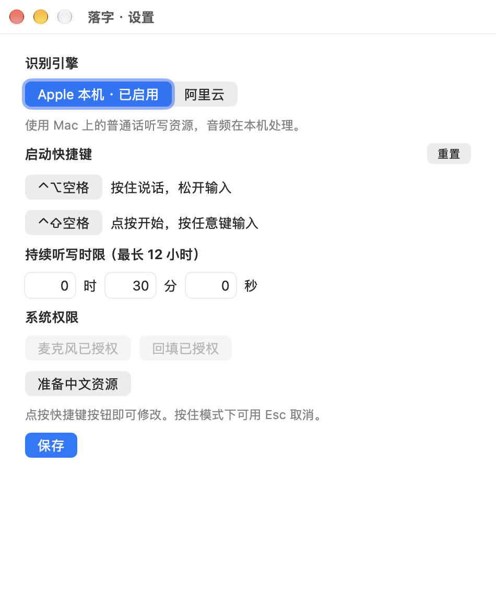

# 落字

落字是 macOS 菜单栏里的语音输入工具。在备忘录、浏览器或聊天窗口按住快捷键说话，松开后，文字就落在当前光标处。没有可写入的输入框时，终稿会复制到剪贴板。

**0.5.0 目前提供源码，需要 macOS 26 或更高版本。** 已在 Apple Silicon 上验证，Intel Mac 尚未验证。Windows 版仍在规划中。当前没有可直接下载的预编译安装包。


## 从源码运行

安装带有 macOS 26 或更新 SDK 的 Xcode，在终端运行以下命令。脚本会按本机架构构建应用。

```sh
git clone https://github.com/inceCheng/luozi.git
cd luozi
./build.sh
open 'build/落字.app'
```

1. 首次启动会打开「落字 · 设置」。点「允许麦克风」和「允许跨应用回填」，按 macOS 提示授权。之后可从菜单栏波形图标进入「设置…」。
2. 默认使用「Apple 本机」。首次使用或缺少普通话听写资源时，点「准备中文资源」。资源就绪后可以离线听写。
3. 打开备忘录，把光标放进一条新笔记，按住 **⌃⌥空格（Control + Option + 空格）** 说一句话再松手。屏幕下方的浮窗显示实时文字，终稿就绪时浮窗关闭，文字写入笔记。

<details>
<summary>查看设置窗口</summary>



</details>

## macOS 快捷键

| 模式 | 0.5.0 初始绑定 | 怎样结束 |
|---|---|---|
| 按住说话 | ⌃⌥空格（Control + Option + 空格） | 松开提交。录音中按 Esc 可取消。 |
| 持续听写 | ⌃⇧空格（Control + Shift + 空格） | 点按后松手继续录音。再按任意普通键（含 Esc）提交，该键会被拦截。要丢弃这次录音，从菜单选「取消本次听写」。 |

习惯用 **Command + Shift + 空格（⌘⇧空格）** 的话，在设置中点击「点按开始，按任意键输入」左侧的快捷键按钮，按下 ⌘⇧空格，再点「保存」。两种模式可以分别改键，也可以给其中一种单独绑定右侧 Control。两组绑定须不同。点「重置」再保存可以恢复初始绑定。

持续听写默认 **30 分钟**，可设为 **1 秒至 12 小时**，到时自动提交。亮度键、Touch ID 等由系统接管的按键可能无法用来结束听写。

## 两种识别引擎怎么选

| | Apple 本机（默认） | 阿里云百炼 |
|---|---|---|
| 写出来的文字 | 直接采用 macOS 普通话听写的结果。口头语、重复和改口可能保留，适合想保留自己措辞的笔记或草稿。 | 使用 `qwen-audio-3.1-asr-flash-message`，已开启模型自带的口语润色。它会尝试清理多余的“嗯”“呃”和重复词，适合边想边说、说完就发的消息。 |
| 联网与费用 | 普通话资源准备好后可离线使用，无需账号或 API Key，没有按次听写费用。 | 边录边传到北京地域，使用自己的 API Key，按输入和输出 Token 计费。网络状况会影响文字出现的速度。 |

例如，口述“嗯，我们，我们下午三点开会”，云端的终稿可能是“我们下午三点开会”。这是效果示意。如果“嗯”是在回答问题，模型也可能保留它。两种引擎都提供临时预览，最终写入的是终稿。[阿里云模型说明与计价](https://help.aliyun.com/zh/model-studio/qwen-audio-3-1-asr-flash-message)

落字当前面向普通话听写。本机识别使用 `zh-CN`，云端请求的 `language_hints` 为 `["zh"]`。设置中暂无英文或其他语言的切换入口。[阿里云语言参数](https://help.aliyun.com/zh/model-studio/qwen-asr-message-client-events)

### 启用阿里云

1. 登录百炼，首次使用按控制台提示完成开通。选择**华北 2（北京）**及要使用的业务空间，确认该空间可调用上述模型。[百炼控制台](https://bailian.console.aliyun.com/) · [业务空间管理](https://bailian.console.aliyun.com/settings/workspace)
2. 在北京地域创建该空间的 API Key，并在创建时复制完整密钥。[北京 API Key 管理](https://bailian.console.aliyun.com/cn-beijing/model/settings/api-key) · [创建说明](https://help.aliyun.com/zh/model-studio/get-api-key/)
3. 在「落字 · 设置」选择「阿里云」，按 ⌘V 或点「粘贴」填入密钥，点「保存」或关闭设置。重新打开时会显示「已保存」和「已启用」。要确认刚才实际用的是哪个引擎，完成一次听写后查看「上次成功转写」。

## 隐私与剪贴板

- **音频**只交给当前选中的引擎。Apple 本机模式在 Mac 上处理音频。启用阿里云后，音频才会发给百炼。落字自身不保存录音文件。
- **密钥和记录**分别保存。API Key 存在 macOS 登录钥匙串。落字在内存里保留最近一次听写，可从菜单复制，退出后清除。本机设置会记住上次成功识别的引擎和时间，使用当前云端模型时也会记住模型名称。
- **回填**优先寻找终稿就绪时有键盘焦点的输入框，其次尝试前台窗口中鼠标下方的可编辑控件。找不到时，终稿留在系统剪贴板供稍后粘贴，退出落字也不会清空它。
- **网页编辑器**可能需要通过 ⌘V 回填。落字仅在有旧剪贴板备份、能确认粘贴成功且期间剪贴板没被改动时恢复旧内容。备份上限为 8 MiB，超过上限或无法读取时，终稿可能留在剪贴板。

## 常见问题

**说完后只复制，没有写进去？** 先点进备忘录的普通文本框试一次。如果菜单中有「当前仅复制 · 开启直接输入…」，点它进入系统权限页，给落字授权。默认源码构建使用临时签名，重建后可能需要重新添加当前的 `build/落字.app`。网页或 Electron 编辑器如果还没报告焦点，可以先用 ⌘V 粘贴终稿。落字会跳过密码框，系统已启用安全输入时也会暂停启动听写。

**快捷键没有反应？** 在设置中确认两种模式各自的绑定。全局快捷键可能已被其他应用占用，可以换一组再保存。持续听写还需要跨应用回填所用的辅助功能权限，以接收结束键。

**结束录音后迟迟没有文字？** 松键或按键结束录音后，落字最多再等 28 秒接收终稿。云端模式下可先检查网络、北京地域 Key 和模型调用权限。如果中途失败时已有确认的片段，可从「复制最近一次听写」取回。

## 开发与测试

界面使用 Swift 和 AppKit，麦克风按需开启。本机用 `SpeechAnalyzer` 和 `DictationTranscriber`，云端通过 WebSocket 发送 16 kHz 单声道 PCM。实现见 [Sources](Sources)。

| 命令 | 检查内容 |
|---|---|
| `./Checks/run.sh` | 用合成普通话测试真实 Apple 引擎，用本地模拟服务测试云端分段、终稿与错误处理。需要本机普通话资源，无需云账号。 |
| `./Checks/input.sh` | 在测试窗口验证快捷键、录音时限、回填、剪贴板和浮窗。先退出落字以释放快捷键，测试进程需有辅助功能权限。 |
| `./Checks/run.sh --live` | 用钥匙串中的北京地域 Key 向阿里云发送一段合成普通话并输出终稿，会消耗账户额度。 |

安装包签名与公证、Mac App Store 和 Windows 版的计划见[发布指南](DISTRIBUTION.md)。报告问题时，请附 macOS 版本、芯片、识别引擎、目标应用、权限状态和复现步骤。请勿附 API Key。[提交问题](https://github.com/inceCheng/luozi/issues)

落字源码按 [MIT 许可证](LICENSE)发布。阿里云服务遵循服务提供方的条款。
